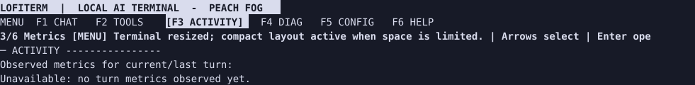
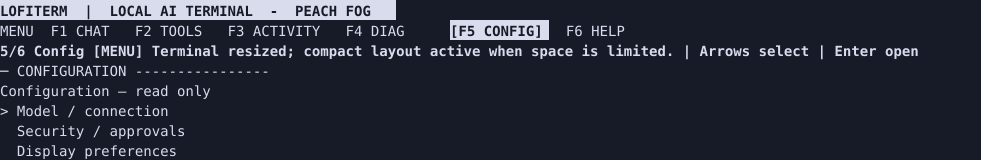
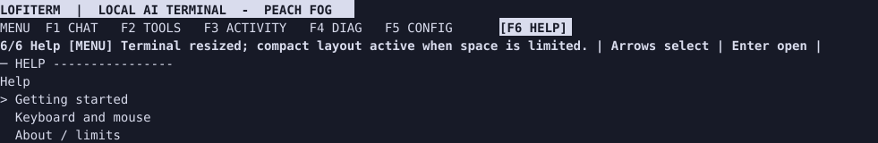
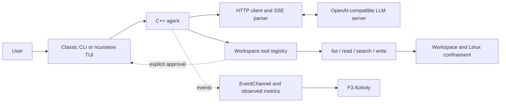

<p align="center">
  
</p>

<p align="center"><strong>A C++20 agent for talking to an OpenAI-compatible LLM server from your terminal.</strong></p>

<p align="center"><a href="README.md">🇫🇷 Français</a> · 🇬🇧 English · <a href="README.es.md">🇪🇸 Español</a></p>

LOFITERM streams responses over SSE and can explore files in a dedicated workspace. The classic command-line interface remains available; the full-screen interface uses ncursesw.

> **Platform: Linux with usable Landlock support.** The application refuses to start if filesystem confinement cannot be enabled. Its limits are described in the [security guide](docs/user/en/05-security-and-limits.md).

## What it does

- Sends requests to `POST /v1/chat/completions` with `stream: true` and displays received fragments as they arrive.
- Exposes four workspace tools to the model: `list_files`, `read_file`, `search_files`, and `write_file`.
- Requires a fresh explicit challenge approval for every `write_file` creation. Denial, timeout, or cancellation does not authorize a write. Existing files are not overwritten.
- Provides a six-view LOFITERM TUI: Conversation, Tools, Activity, Diagnostics, Configuration, and Help.
- Shows observed measurements in Activity. SSE fragments are not tokens; incomplete event details are marked `PARTIAL`.

Tools are invoked at the model's discretion, not through shell commands entered in the REPL. The agent exposes only its declared functions; it does not provide a shell tool.

<a id="tui-preview"></a>
## TUI preview

These screens were captured from a tmux PTY at 110×32 using the binary built from SHA `39646ffade1c71ece9995fde7770dcf428e45d3a`, with default configuration and no LLM request. They are terminal-render captures, **not a Ghostty qualification**.

| Conversation | Activity (F3) |
| --- | --- |
|  |  |

| Configuration (F5) | Help (F6) |
| --- | --- |
|  |  |

## Build from source

Requirements: Linux/Landlock, CMake 3.20+, a C++20 compiler, libcurl, ncursesw, and access to CMake FetchContent for `nlohmann/json` 3.11.3.

```sh
repo_dir=$PWD
sudo apt install build-essential cmake libcurl4-openssl-dev libncurses-dev
cmake -S . -B build
cmake --build build -j2
cp .env.example .env
chmod 600 .env
# Edit .env with your endpoint and, if needed, the server key.
set -a; . ./.env; set +a
mkdir -p "$HOME/lofiterm-workspace"
cd "$HOME/lofiterm-workspace"
"$repo_dir/build/agent" --ui=tui
```

From a source build, the workspace is `workspace/` below the process current working directory. This example selects a dedicated user directory.

From the selected directory above, run the classic interface with `"$repo_dir/build/agent" --ui=classic` or with no option. In a source build, `workspace/` remains relative to the process's launch directory.

## Debian installation

The repository includes a local Debian 13 amd64 package recipe. See [Debian 13 installation](docs/INSTALL_DEBIAN13.md) and the [getting-started guide](docs/user/en/01-getting-started.md). There is no public APT repository. The project's original code is [0BSD-licensed](LICENSE). Third-party dependencies retain their own licenses; the Debian package is a local recipe, not an official release.

## Guides

- [Getting started, installation, and configuration](docs/user/en/01-getting-started.md)
- [Classic interface and REPL](docs/user/en/02-classic-interface.md)
- [LOFITERM TUI](docs/user/en/03-tui.md)
- [Workspace tools](docs/user/en/04-workspace-tools.md)
- [Security and limitations](docs/user/en/05-security-and-limits.md)
- [Tutorials, troubleshooting, and FAQ](docs/user/en/06-tutorials-troubleshooting-faq.md)
- [Simplified architecture](docs/user/en/07-architecture.md)
- [Documentation index and language versions](docs/README.md)

## Version and status

The `v1.0.0-technical` tag identifies an earlier qualified technical baseline; it is not a claim that LOFITERM has a product release. The public name is **LOFITERM**; the repository, CMake target, and source-build executable remain `local-agent-cpp` / `agent`.

Debian/Ghostty qualification, manual trials, and test counts are dated and tied to their SHAs in [`docs/reports/`](docs/README.md). They do not guarantee behavior on every terminal, server, model, or Linux kernel.

## Architecture at a glance



See the [detailed architecture guide](docs/user/en/07-architecture.md). Diagrams describe the shipped code, not every proposal in historical specifications.

## License

LOFITERM's original code and documentation are released under the [BSD Zero-Clause license (0BSD)](LICENSE). Commercial use and redistribution require no attribution. Third-party components retain their own licenses.

## Contributing

Read [AGENTS.md](AGENTS.md) before changing the project. Changes intended for `main` go through a dedicated branch and pull request; do not rewrite historical reports to make them appear current.
