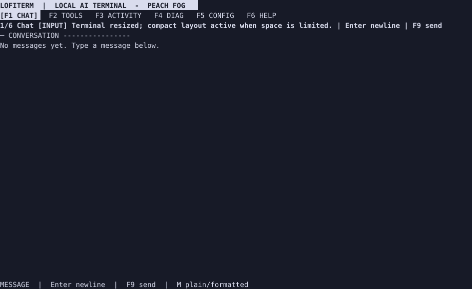
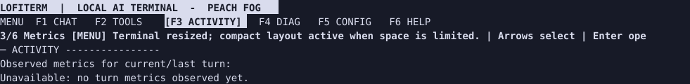
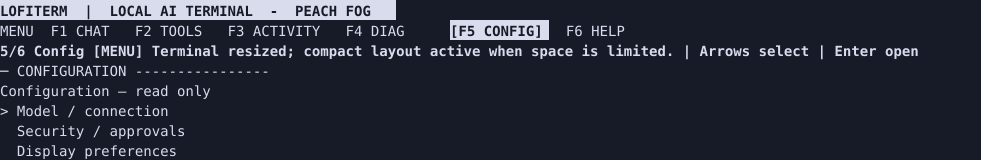
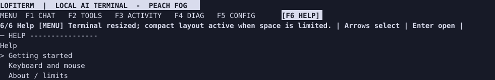
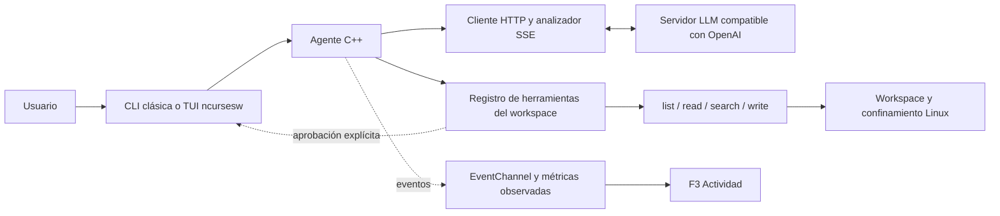

<p align="center">
  
</p>

<p align="center"><strong>Un agente C++20 para conversar desde la terminal con un servidor LLM compatible con OpenAI.</strong></p>

<p align="center"><a href="README.md">🇫🇷 Français</a> · <a href="README.en.md">🇬🇧 English</a> · 🇪🇸 Español</p>

LOFITERM transmite las respuestas mediante SSE y puede explorar archivos de un workspace dedicado. Mantiene una interfaz clásica de línea de comandos y ofrece una interfaz de pantalla completa basada en ncursesw.

> **Plataforma: Linux con Landlock disponible y activable.** La aplicación se niega a iniciarse si no puede habilitar el confinamiento del sistema de archivos. Sus límites se explican en la [guía de seguridad](docs/user/es/05-seguridad-y-limites.md).

## Qué hace

- Envía solicitudes a `POST /v1/chat/completions` con `stream: true` y muestra los fragmentos a medida que llegan.
- Expone cuatro herramientas de workspace al modelo: `list_files`, `read_file`, `search_files` y `write_file`.
- Exige una aprobación explícita con un desafío nuevo para cada creación `write_file`. Una denegación, caducidad o cancelación no autoriza la escritura. No se sobrescriben archivos existentes.
- Incluye una TUI LOFITERM de seis vistas: Conversación, Herramientas, Actividad, Diagnóstico, Configuración y Ayuda.
- Muestra en Actividad las mediciones observadas. Los fragmentos SSE no son tokens; los detalles incompletos se marcan `PARTIAL`.

El modelo decide cuándo invocar las herramientas; no se ejecutan como comandos de shell escritos en el REPL. El agente solo expone las funciones declaradas y no ofrece una herramienta de shell.

<a id="tui-preview"></a>
## Vista previa de la TUI

Estas pantallas se capturaron desde un PTY de tmux de 110×32 con el binario compilado desde el SHA `39646ffade1c71ece9995fde7770dcf428e45d3a`, configuración predeterminada y sin solicitudes al LLM. Son capturas del terminal, **no una calificación en Ghostty**.

| Conversación | Actividad (F3) |
| --- | --- |
|  |  |

| Configuración (F5) | Ayuda (F6) |
| --- | --- |
|  |  |

## Compilar desde el código fuente

Requisitos: Linux/Landlock, CMake 3.20 o posterior, compilador C++20, libcurl, ncursesw y acceso a FetchContent de CMake para `nlohmann/json` 3.11.3.

```sh
repo_dir=$PWD
sudo apt install build-essential cmake libcurl4-openssl-dev libncurses-dev
cmake -S . -B build
cmake --build build -j2
cp .env.example .env
chmod 600 .env
# Edita .env con el endpoint y, si hace falta, la clave del servidor.
set -a; . ./.env; set +a
mkdir -p "$HOME/lofiterm-workspace"
cd "$HOME/lofiterm-workspace"
"$repo_dir/build/agent" --ui=tui
```

En una compilación desde fuentes, el workspace es `workspace/` bajo el directorio de trabajo del proceso. Este ejemplo elige un directorio de usuario dedicado.

Desde el directorio elegido arriba, inicia la interfaz clásica con `"$repo_dir/build/agent" --ui=classic` o sin opción. En una compilación desde fuentes, `workspace/` sigue siendo relativo al directorio desde el que se inicia el proceso.

## Instalación en Debian

El repositorio incluye una receta para generar un paquete local Debian 13 amd64. Consulta [instalación en Debian 13](docs/INSTALL_DEBIAN13.md) y la [guía de inicio](docs/user/es/01-primeros-pasos.md). No hay un repositorio APT público. El código fuente no declara una licencia de redistribución; no distribuyas el paquete hasta que se aclare.

## Guías

- [Primeros pasos, instalación y configuración](docs/user/es/01-primeros-pasos.md)
- [Interfaz clásica y REPL](docs/user/es/02-interfaz-clasica.md)
- [TUI LOFITERM](docs/user/es/03-tui.md)
- [Herramientas del workspace](docs/user/es/04-herramientas-workspace.md)
- [Seguridad y limitaciones](docs/user/es/05-seguridad-y-limites.md)
- [Tutoriales, solución de problemas y preguntas frecuentes](docs/user/es/06-tutoriales-solucion-problemas-faq.md)
- [Arquitectura simplificada](docs/user/es/07-arquitectura.md)
- [Índice y versiones lingüísticas](docs/README.md)

## Versión y estado

La etiqueta `v1.0.0-technical` identifica una base técnica anterior que fue calificada; no afirma que LOFITERM tenga una versión de producto publicada. El nombre público es **LOFITERM**; el repositorio, el objetivo CMake y el ejecutable compilado desde fuentes siguen llamándose `local-agent-cpp` / `agent`.

Las calificaciones Debian/Ghostty, pruebas manuales y cifras de pruebas están fechadas y vinculadas a sus SHA en [`docs/reports/`](docs/README.md). No garantizan el funcionamiento en todos los terminales, servidores, modelos o kernels Linux.

## Arquitectura de un vistazo



Consulta la [guía detallada de arquitectura](docs/user/es/07-arquitectura.md). Los diagramas describen el código disponible, no todas las propuestas de las especificaciones históricas.

## Contribuir

Lee [AGENTS.md](AGENTS.md) antes de modificar el proyecto. Los cambios destinados a `main` se envían desde una rama dedicada mediante una pull request; no reescribas los informes históricos para presentarlos como actuales.
