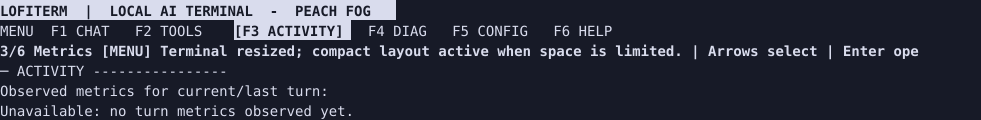
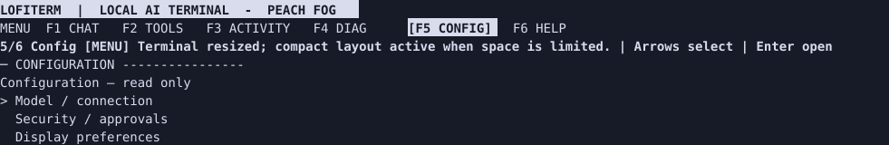
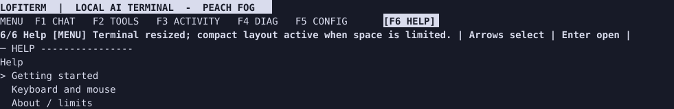
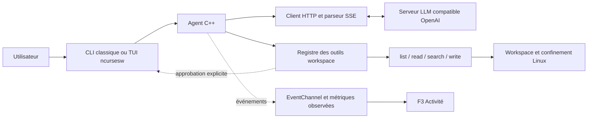

<p align="center">
  
</p>

<p align="center"><strong>Un agent C++20 pour parler à un serveur LLM compatible OpenAI, dans votre terminal.</strong></p>

<p align="center">🇫🇷 Français · <a href="README.en.md">🇬🇧 English</a> · <a href="README.es.md">🇪🇸 Español</a></p>

LOFITERM diffuse les réponses au fil d'un flux SSE et peut explorer les fichiers d'un workspace dédié. La CLI classique reste disponible; l'interface plein écran s'appuie sur ncursesw.

> **Plateforme : Linux avec Landlock activable.** L'application refuse de démarrer si le confinement filesystem ne peut pas être installé. Les limites de cette barrière sont décrites dans le [guide sécurité](docs/user/fr/05-securite-limites.md).

## Ce que le programme fait

- Envoie des échanges à `POST /v1/chat/completions` avec `stream: true` et affiche les fragments reçus.
- Offre quatre outils workspace au modèle : `list_files`, `read_file`, `search_files` et `write_file`.
- Exige une approbation explicite par défi pour chaque création `write_file`; le refus, l'expiration ou l'annulation n'autorisent pas l'écriture. Les fichiers existants ne sont pas écrasés.
- Propose une TUI LOFITERM à six vues : Conversation, Outils, Activité, Diagnostics, Configuration et Aide.
- Affiche dans Activité les mesures réellement observées. Les fragments SSE ne sont pas des tokens; les détails incomplets sont signalés `PARTIAL`.

Les outils sont appelés par décision du modèle, pas par des commandes shell saisies dans le REPL. Le modèle ne reçoit que les fonctions déclarées par l'agent; aucun outil shell n'est fourni.

<a id="tui-preview"></a>
## Aperçu de la TUI

Les vues ci-dessous ont été capturées dans un PTY tmux 110×32 depuis le binaire construit au SHA `39646ffade1c71ece9995fde7770dcf428e45d3a`, avec configuration par défaut et sans requête LLM. Ce sont des captures de rendu terminal, **pas une qualification Ghostty**.

| Conversation | Activité (F3) |
| --- | --- |
|  |  |

| Configuration (F5) | Aide (F6) |
| --- | --- |
|  |  |

## Démarrage depuis les sources

Prérequis : Linux/Landlock, CMake 3.20+, compilateur C++20, libcurl, ncursesw et accès à FetchContent pour récupérer `nlohmann/json` 3.11.3.

```sh
repo_dir=$PWD
sudo apt install build-essential cmake libcurl4-openssl-dev libncurses-dev
cmake -S . -B build
cmake --build build -j2
cp .env.example .env
chmod 600 .env
# Éditer .env avec l'endpoint et, si nécessaire, la clé du serveur.
set -a; . ./.env; set +a
mkdir -p "$HOME/lofiterm-workspace"
cd "$HOME/lofiterm-workspace"
"$repo_dir/build/agent" --ui=tui
```

Depuis les sources, le workspace est `workspace/` sous le répertoire courant du processus. Cet exemple choisit un répertoire utilisateur dédié.

Depuis le répertoire choisi ci-dessus, le mode classique se lance avec `"$repo_dir/build/agent" --ui=classic` (ou sans option). Depuis les sources, `workspace/` reste relatif au répertoire courant de lancement.

## Installation Debian

Le dépôt contient une recette de paquet local Debian 13 amd64. Consultez [l'installation Debian 13](docs/INSTALL_DEBIAN13.md) et le [guide de démarrage](docs/user/fr/01-demarrage-installation.md). Il n'existe pas de dépôt APT public. Le code original du projet est sous [licence 0BSD](LICENSE). Les dépendances tierces conservent leurs propres licences ; le paquet Debian reste une recette locale, non une release officielle.

## Guides

- [Démarrage, installation et configuration](docs/user/fr/01-demarrage-installation.md)
- [Interface classique et REPL](docs/user/fr/02-interface-classique.md)
- [Interface TUI LOFITERM](docs/user/fr/03-interface-tui.md)
- [Outils workspace](docs/user/fr/04-outils-workspace.md)
- [Sécurité et limites](docs/user/fr/05-securite-limites.md)
- [Tutoriels, dépannage et FAQ](docs/user/fr/06-tutoriels-depannage-faq.md)
- [Architecture simplifiée](docs/user/fr/07-architecture.md)
- [Index et versions linguistiques](docs/README.md)

## État et versions

Le tag `v1.0.0-technical` identifie une base technique qualifiée antérieure; ce n'est pas une affirmation de release produit LOFITERM. Le nom public est **LOFITERM**; le dépôt, la cible CMake et le binaire compilé depuis les sources restent `local-agent-cpp` / `agent`.

La qualification Debian/Ghostty, les essais manuels et les compteurs de tests sont datés et rattachés à leurs SHA dans [`docs/reports/`](docs/README.md). Ils ne garantissent pas chaque terminal, serveur, modèle ou noyau Linux.

## Architecture en une vue



Voir [l'architecture détaillée](docs/user/fr/07-architecture.md). Les schémas décrivent le code livré, pas toutes les propositions des anciennes spécifications.

## Licence

Le code et la documentation originale de LOFITERM sont diffusés sous la [licence BSD Zero-Clause (0BSD)](LICENSE). Usage commercial et redistribution sans attribution obligatoire. Les dépendances tierces restent soumises à leurs licences.

## Contribuer

Consultez [AGENTS.md](AGENTS.md) avant toute modification. Les changements destinés à `main` passent par une branche et une pull request; ne modifiez pas les rapports historiques pour les mettre artificiellement à jour.
