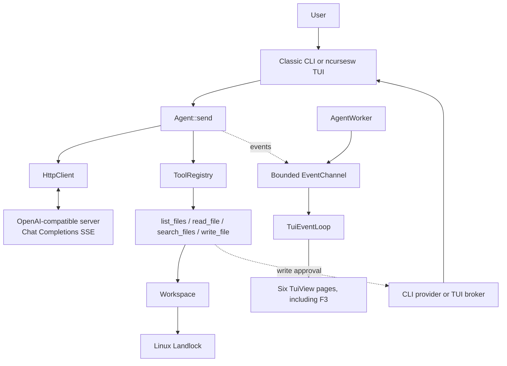

# Simplified architecture

[🇫🇷 Français](../fr/07-architecture.md) · 🇬🇧 English · [🇪🇸 Español](../es/07-arquitectura.md)

## Components

- **`agent`**: entry point, environment configuration, workspace, and interface selection.
- **`Agent`**: assembles messages, manages conversation history, processes API responses, and dispatches tool calls.
- **`HttpClient` + SSE parser**: HTTP transport and event framing. The client handles stream completion and errors according to its contract; it is not a wrapper for arbitrary proprietary endpoints.
- **`ToolRegistry` and workspace tools**: four functions without shell access, with path validation and dedicated filesystem operations.
- **Landlock**: Linux process-level confinement installed before the REPL.
- **Classic CLI**: synchronous single-line or multiline REPL.
- **TUI**: `AgentWorker` runs the agent on its worker thread; `EventChannel` passes events to the ncurses thread; `MetricCollector` retains measurements; `TuiView` projects six views.
- **Approval**: console provider in the CLI, and a separate non-blocking broker for the TUI. The writer receives `PreparedWrite` only after approval.

Metrics derive from events that are received; lost events can make details partial. Retained detail history is bounded, but those caps do not bound process-wide memory. The application does not persist conversation history.

See the [README](../../../README.en.md) for the overview and [USAGE](../../../USAGE.en.md) for user workflows.
