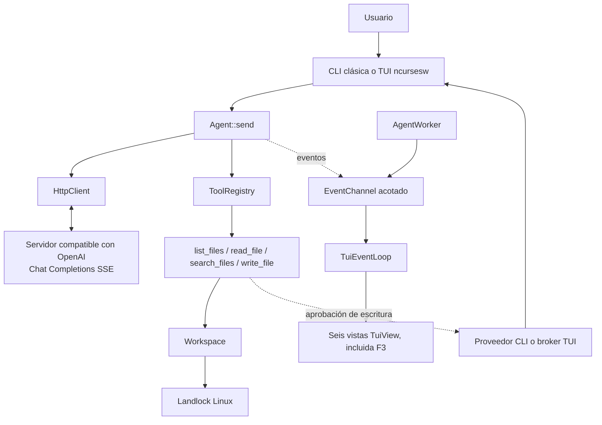

# Arquitectura simplificada

[🇫🇷 Français](../fr/07-architecture.md) · [🇬🇧 English](../en/07-architecture.md) · 🇪🇸 Español

## Componentes

- **`agent`**: punto de entrada, configuración del entorno, workspace y selección de interfaz.
- **`Agent`**: construye mensajes, gestiona el historial, procesa respuestas y despacha llamadas a herramientas.
- **`HttpClient` + analizador SSE**: transporte HTTP y separación de tramas. El cliente controla la finalización y los errores según su contrato; no es un wrapper para cualquier endpoint propietario.
- **`ToolRegistry` y herramientas de workspace**: cuatro funciones sin shell, validación de rutas y operaciones de archivos dedicadas.
- **Landlock**: confinamiento del proceso en Linux, aplicado antes del REPL.
- **CLI clásica**: REPL síncrono de una línea o multilínea.
- **TUI**: `AgentWorker` ejecuta el agente en su hilo; `EventChannel` lleva eventos al hilo ncurses; `MetricCollector` conserva mediciones; `TuiView` proyecta seis vistas.
- **Aprobación**: proveedor de consola en CLI y broker independiente no bloqueante en la TUI. El writer recibe `PreparedWrite` únicamente tras aprobación.

Las métricas derivan de los eventos recibidos; las pérdidas pueden dejar detalles parciales. El historial detallado retenido está acotado, pero esos límites no acotan la memoria total del proceso. La aplicación no persiste el historial de conversación.

Consulta el [README](../../../README.es.md) para el resumen y [USAGE](../../../USAGE.es.md) para los recorridos de usuario.
