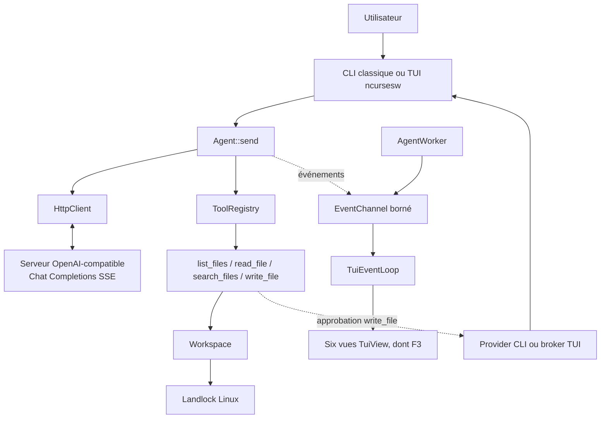

# Architecture simplifiée

🇫🇷 Français · [🇬🇧 English](../en/07-architecture.md) · [🇪🇸 Español](../es/07-arquitectura.md)

## Composants

- **`agent`** : point d'entrée, configuration de l'environnement, workspace et sélection d'interface.
- **`Agent`** : construit les échanges, gère l'historique, traite les réponses de l'API et dispatch les appels d'outils.
- **`HttpClient` + parseur SSE** : transport HTTP et découpage de trames. Le client traite la fin de flux et les erreurs selon son contrat; il n'est pas un wrapper pour un endpoint propriétaire arbitraire.
- **`ToolRegistry` et outils workspace** : quatre fonctions sans shell; validations de chemins et opérations filesystem dédiées.
- **Landlock** : confinement au niveau du processus Linux, installé avant le REPL.
- **CLI classique** : REPL synchrone simple ou multiligne.
- **TUI** : `AgentWorker` exécute l'agent sur son thread, `EventChannel` transporte les événements au thread ncurses, `MetricCollector` conserve les mesures et `TuiView` projette les six vues.
- **Approbation** : provider console en CLI, broker distinct et non bloquant pour la TUI. Le writer reçoit un `PreparedWrite` seulement après accord.

Les métriques sont dérivées des événements reçus; une perte de canal peut rendre les détails partiels. Le collecteur est borné pour les historiques de détails, mais ces plafonds ne représentent pas la mémoire globale du processus. Aucun stockage applicatif persistant des conversations n'est implémenté.

Voir [README](../../../README.md) pour la vue générale et [USAGE](../../../USAGE.md) pour les parcours utilisateurs.
